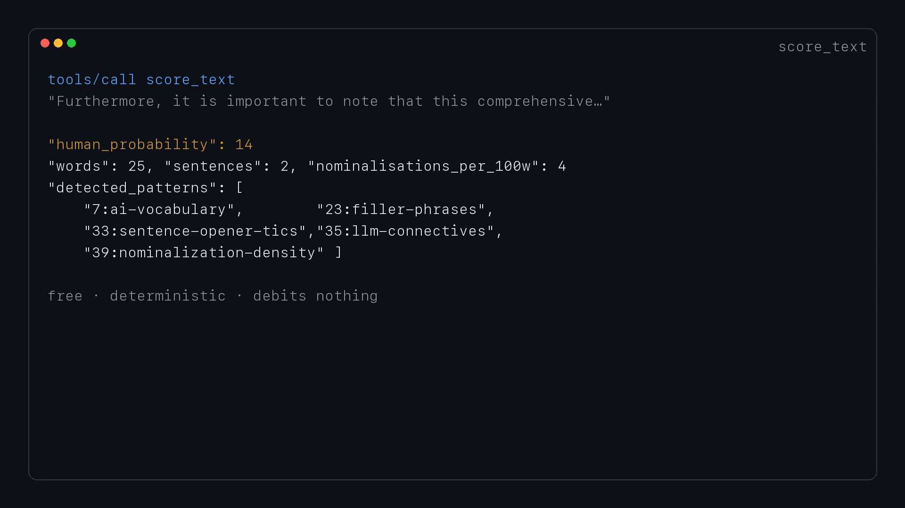

# besthumanizer for Hermes Agent


Three tools over MCP: measure how machine-written a passage reads, rewrite it so it doesn't, and
score a public X account's recent posts.

```bash
hermes plugins install shagghiesuperstar/hermes-besthumanizer --enable
export BESTHUMANIZER_API_KEY=bh_live_...   # from https://besthumanizer.app/account
```

Requires Hermes `>=0.21.0` (tools + the `transform_tool_result` hook). Under Hermes the key is
read through the active profile's secret scope, so a multiplexed fleet can't pick up another
profile's key; outside Hermes it falls back to the environment variable.



## Tools

| tool | what it does | cost |
|---|---|---|
| `score_text` | 0-100 human-probability, plus each pattern found and the span that fired it | free, deterministic, no model |
| `humanize_text` | removes the tells, runs a constrained model pass, re-scans; never returns text scoring lower than the input | meters input words |
| `score_x_account` | median score, distribution and per-post evidence for a public account | free, deterministic |

Scoring is measured, not decorative: same input, same number, every time. That is what makes the
before/after pair meaningful — you can check the rewrite rather than trust it.

## Contract

`humanize_text` measures the document before and after and ships whichever of {your text, the
mechanical pass, the model pass} reads most human. On text that already reads human it hands your
text back and says so in `llm` (`already read human, left as written`). A humanizer that makes
good prose worse is the failure mode this exists to prevent.

## The hook

Installing the plugin also extends Hermes's tool pipeline: `transform_tool_result` inspects any
post/send/publish-shaped tool call (X posts, DMs, email, comments), scores the text being shipped
with the free deterministic scorer, and appends a one-line verdict when it reads under 80/100:

```
[besthumanizer] before this goes out: reads 17/100 human … Firing: significance-inflation, ai-vocabulary
```

It costs no words and no model, so it runs on every send. It only annotates — it never rewrites
what you already committed to, because a hook that silently edits an outbound message is a bug.

## Transport

The plugin is a thin MCP client: every call is one JSON-RPC `tools/call` against
`https://besthumanizer.app/mcp` with `Authorization: Bearer $BESTHUMANIZER_API_KEY`. No REST
dialect, no local scoring code. Set `BESTHUMANIZER_URL` to point at a self-hosted instance.

Prefer plain MCP to a plugin? Same endpoint, no install:

```yaml
mcp_servers:
  besthumanizer:
    url: "https://besthumanizer.app/mcp"
    headers:
      Authorization: "Bearer bh_live_..."
```

OAuth 2.1 with PKCE is also supported at the same URL for clients that require it.

## Tests

`python tests/test_hook.py` — ten assertions over the hook contract, no network and no Hermes
needed: silent without a key, annotates a low-scoring send, leaves already-human text alone,
ignores non-shipping tools and short text, never raises into a turn, and reads the key through
`agent.secret_scope` when Hermes provides one. CI runs it on 3.10 and 3.12.

